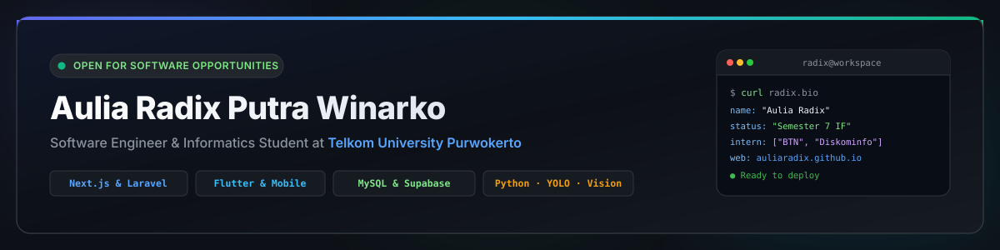

  

  
  
  

---

### 👨‍💻 About Me

I am **Aulia Radix Putra Winarko**, an Informatics Engineering student at **Telkom University Purwokerto** (7th Semester) and a passionate **Software Engineer**. I bridge the gap between functional design and scalable engineering—building responsive web applications, cross-platform mobile experiences, and applied machine learning models.

* 🎓 **Education:** Informatics Engineering (S1) at **Telkom University Purwokerto** (Expected Graduation: 2027).
* 💼 **Industry Track Record:**
  * **Bank BTN (Bank Tabungan Negara KC Pekalongan):** Developed automated digital queue and ticketing prototypes across multi-tier roles (`User`, `Petugas`, `Super Admin`) to streamline banking operational workflows.
  * **Diskominfo Pekalongan:** Contributed to municipal web administration, regional software initiatives, and IT service documentation.
* 🚀 **Current Focus:** Full-stack systems architecture with **Next.js** & **Laravel**, cross-platform mobile apps with **Flutter**, and applied computer vision with **YOLOv8** & **MobileNet**.
* 🎯 **Available For:** Software Engineering Internships, Freelance Development Projects, and Research Collaborations.

---

### 🛠️ Technical Arsenal

| Domain | Technologies & Frameworks |
| :--- | :--- |
| **Frontend & Web** |       |
| **Backend & APIs** |      |
| **Mobile Development** |    |
| **Databases & Cloud** |    |
| **Applied AI & ML** |     |
| **UI/UX & Creative** |       |
| **Tooling & Workflow** |      |

---

### 🌟 Featured Repositories & Real-World Projects

* **[auliaradix.github.io](https://github.com/AuliaRadix/auliaradix.github.io)**
  * *Modern Glassmorphic Developer Portfolio v2*
  * Built with Next.js 14, Tailwind CSS, and frosted glass design system. Deployed live on GitHub Pages with interactive filtering, verified internship tracks, and direct contact options.
* **[Bank BTN Digital Queue & Ticketing System](https://github.com/AuliaRadix/Prototype-Pengambilan-Tiket-BTN-super-admin)**
  * *Enterprise Banking Queue Prototype*
  * Engineered a comprehensive three-tier role system ([Super Admin](https://github.com/AuliaRadix/Prototype-Pengambilan-Tiket-BTN-super-admin), [Petugas](https://github.com/AuliaRadix/Prototype-Pengambilan-Tiket-BTN-petugas), and [User/Customer](https://github.com/AuliaRadix/Prototype-Pengambilan-Tiket-BTN-user-)) to automate customer token dispensing and teller routing during Bank BTN KC Pekalongan internship.
* **[Web Scraping & Data Extraction Suite](https://github.com/AuliaRadix/web-scraping-and-data-extraction-portfolio)**
  * *Automated E-Commerce & Business Intelligence Collector*
  * Python-based automation engine for parsing complex web structures, pagination handling, and sanitizing output directly to clean Excel (`.xlsx`) and CSV formats.
* **[RSUD Bendan Healthcare Platform](https://github.com/AuliaRadix/RSUD-BENDAN)**
  * *Regional Hospital Management & Queue System*
  * Web application prototype for hospital department scheduling, queue tracking, and administrative monitoring ([Public Portal](https://github.com/AuliaRadix/RSUD-BENDAN) & [Admin Console](https://github.com/AuliaRadix/ADMIN-RSUD-BENDAN)).
* **[Mobile Abasen](https://github.com/AuliaRadix/Moblie_Abasen)**
  * *Flutter-Based Mobile Attendance App*
  * Cross-platform attendance verification application with responsive mobile layout and data sync.

---

### 📊 GitHub Activity & Insights

  
  

---

### 📬 Get In Touch

I am always keen to discuss software engineering, technical collaboration, or internship opportunities:

* 🌐 **Portfolio:** [auliaradix.github.io](https://auliaradix.github.io)
* ✉️ **Contact:** Reach out directly through the [Portfolio Contact Form](https://auliaradix.github.io#contact)
* 📍 **Location:** Purwokerto & Pekalongan, Central Java, Indonesia
* ⚡ **Fun Fact:** When not writing code, I analyze computer vision workflows and build custom autonomous agent tooling.

  Designed &amp; Maintained by <b>Aulia Radix Putra Winarko</b> · Built with modern developer taste

